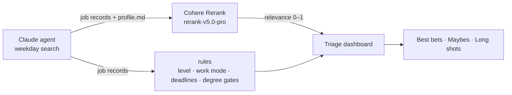

# Job triage with Cohere Rerank

A personal job-search agent that ranks postings by how well they fit me.

Each weekday a Claude agent scans job boards and employer career pages for
developer roles workable from Toronto. Each role is saved as a structured record.
This script sends the records to **Cohere Rerank** with my candidate profile as
the query. Rerank's relevance scores then drive the "fit" part of a triage
dashboard I use to decide where to spend my applications.



## How it works

- **Query:** [`profile.md`](profile.md), a short plain-language description of
  what I'm looking for and what I bring: early-career front-end/full-stack work,
  React/TypeScript/Python, accessibility, data visualization, my degrees, and
  sector preferences.
- **Documents:** each job record rendered as YAML-style text (title, company,
  level, stack, education requirement, the agent's summary and caveats, and the
  posting text when available). Bookkeeping fields like URLs and run dates are
  left out so they can't affect relevance.
- **One request per run.** Rerank accepts up to 1,000 documents per call, so the
  whole day's batch goes in a single `POST /v2/rerank`.
- **Scores feed the dashboard.** Relevance maps to up to 35 of 100 points:
  ≤0.20 earns nothing and ≥0.55 earns the maximum. Rule-based checks handle
  what a relevance model shouldn't guess, such as experience level, work mode,
  deadlines, unverified listings, and hard CS-degree gates.

Why Rerank rather than keyword matching: the old version scored stack fit by hand
("strong", "partial"). Rerank picks up things those labels missed:

- **Same stack, different level.** PolicyMe posted three roles with the same
  stack (Python, React, Redux, PostgreSQL, AWS). My labels rated all three a
  "full" stack match. Rerank ranked the Junior role #2, the mid-level role #15,
  and the Senior role #61.
- **A label I got wrong.** I rated a Senior Full Stack AI-Native Engineer role
  a "strong" match because React and TypeScript appear in the posting. Its stack
  is mostly Java, Spring, Angular and Kubernetes, and Rerank ranked it #148.

Rerank sees each posting's title and the agent's level tag. It weighs them
together with the stack against the profile; my labels only rated stack.

## Results (181 postings, current profile)

| Rank | Relevance | Role |
|---:|---:|---|
| 1 | 0.571 | Software Engineer, Full-Stack (Early Career) · Superhuman |
| 2 | 0.548 | Junior Software Engineer (AI-Driven Full Stack) · PolicyMe |
| 3 | 0.517 | Full Stack Software Engineer · Atlassian |
| 4 | 0.503 | Web Developer · Cohere |
| 5 | 0.494 | Intern, Full Stack Software Engineer · Capital One |
| 6 | 0.475 | Software Engineer, Fullstack · WorkWhile |
| 7 | 0.457 | Full-Stack Software Engineer (New & Recent Graduates) · Wanderlog |
| … | | |
| 181 | 0.042 | Data analyst roles from an earlier, broader search |

The profile deliberately doesn't name any employer or vendor. An earlier draft
listed "Cohere API" as a skill, and the word alone lifted Cohere's own postings
(their Web Developer role went from #4 to #2), so it was removed.

Median relevance was 0.32. The same posting gets the same score on different
days (Rerank scores each query–document pair on its own), so roles found on
different days can be compared directly.

## Run it

Requires Python 3.9+ and nothing else. It calls the REST API with the standard library.

```bash
export COHERE_API_KEY=...        # free trial key from dashboard.cohere.com
python3 rerank.py examples       # 4 sample postings
python3 rerank.py path/to/jobs --out scores.json --top 15
```

Output: `scores.json` mapping each record's id to its relevance score, plus a
ranked list printed to the terminal.

## Files

- `rerank.py`: builds the documents, calls Rerank, and writes the scores
- `profile.md`: the query (my candidate profile)
- `examples/`: four real job records from the search, from a strong match to a clear miss
